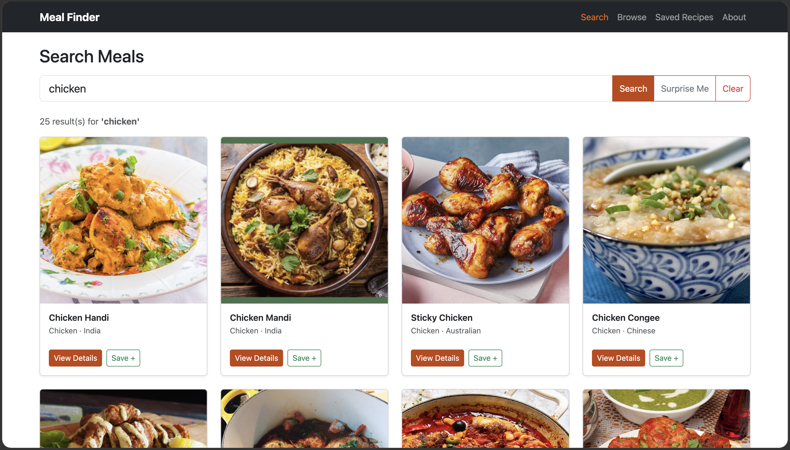
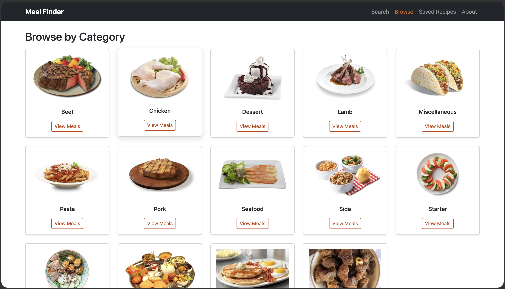
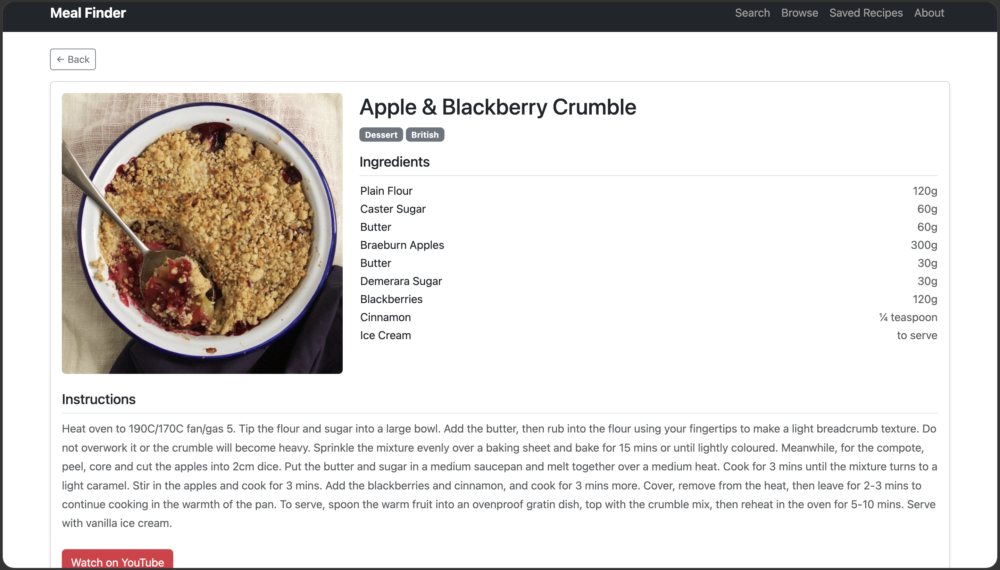
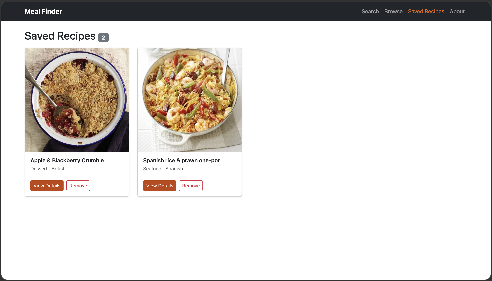
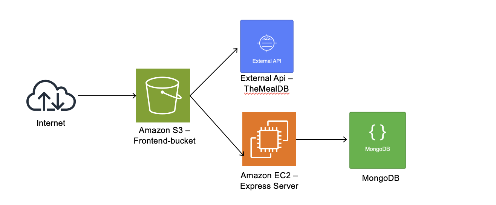
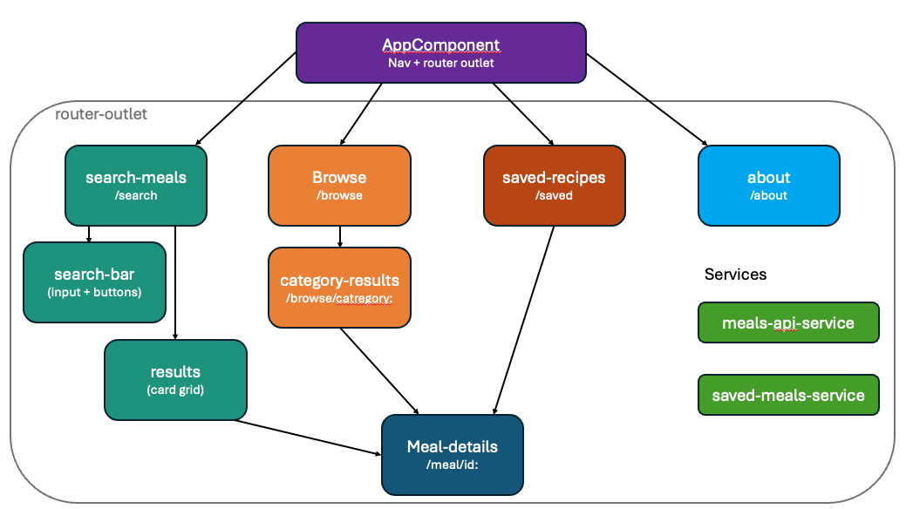

# Meal Finder

An Angular web app for discovering recipes from around the world. Search by name, browse by category, or get a random meal, then save your favourites to a cloud-hosted database.

Built as my Web Programming 1 project in second year of BSc Software Development at ATU Sligo. The front end is hosted on Amazon S3, and saved recipes go to an Express API running on Amazon EC2, backed by MongoDB.

## Features

- **Search:** look up meals by name, or hit "Surprise Me" for a random recipe
- **Browse:** explore meals by category (Beef, Chicken, Dessert, Seafood and more)
- **Meal details:** full ingredient list with measurements, cooking instructions and a link to a YouTube video
- **Saved recipes:** save and remove favourites, stored in MongoDB through my own REST API

| Browse | Meal details | Saved recipes |
|---|---|---|
|  |  |  |

## Tech stack

- **Front end:** Angular 21 (standalone components, signals, routing), TypeScript, Bootstrap 5
- **Back end:** Node.js, Express, MongoDB (Atlas)
- **Hosting:** Amazon S3 (front end), Amazon EC2 (API)
- **External API:** [TheMealDB](https://www.themealdb.com/api.php)

## Architecture

The Angular app calls TheMealDB directly for searching, browsing and meal details. When a user saves a recipe, the app fetches the full meal record from TheMealDB first, then posts it to the Express API on EC2, which stores it in MongoDB. This makes sure saved meals never have missing fields, even when they were saved from a list view that only had partial data.

### Front-end structure

- `MealsApiService` handles all calls to TheMealDB and exposes results as Angular signals.
- `SavedMealsService` handles saving, loading and removing recipes through the Express API.
- Components are split by page (search, browse, category, saved, details, about), with the search page broken into a reusable search bar and results grid.

### API endpoints

| Method | Endpoint | Description |
|---|---|---|
| GET | `/meals` | List saved meals |
| GET | `/meals/:id` | Get one saved meal |
| POST | `/meals` | Save a meal |
| DELETE | `/meals/:id` | Remove a saved meal |

The Express server structure was adapted from MongoDB's Express REST API sample application.

## Running it locally

**API**

1. `cd api-server`
2. Create a `.env` file containing your MongoDB connection string: `ATLAS_URI=<your connection string>`
3. `npm install`, then `npm start` (runs on port 5050)

**Front end**

1. From the project root, run `npm install`
2. `ng serve`, then open `http://localhost:4200`

The development build points at `http://localhost:5050/meals` (see `src/environments`).

## What I'd improve next

- Add user accounts so each person has their own saved recipes
- Serve the API over HTTPS behind a domain instead of a raw EC2 IP address
- Write real unit tests for the services (the current spec files are the Angular defaults)
- Add loading and error states for when an API call fails
